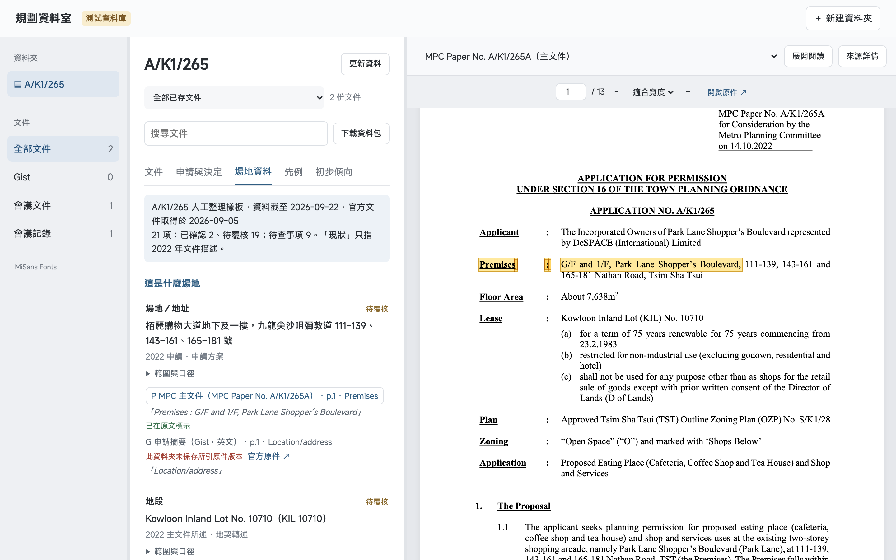
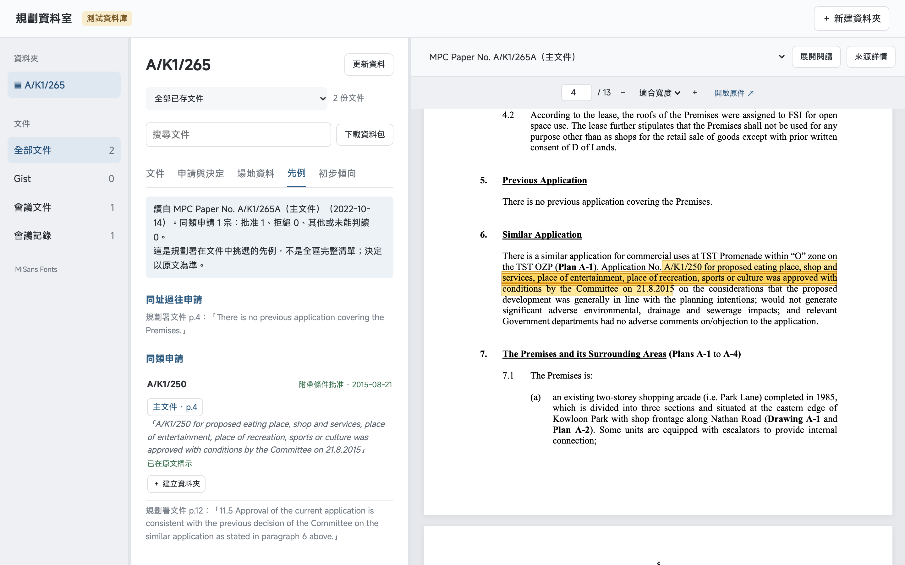
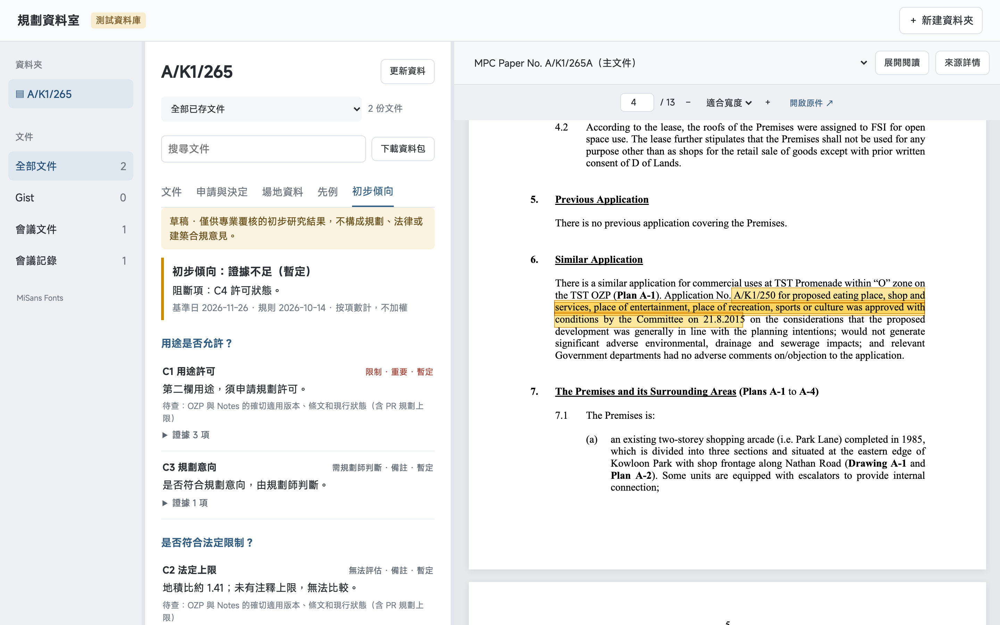

# 规划资料室 · Planning Research Library

面向香港城市规划背景调查（Planning Research）工作流的本地原型：输入完整规划申请编号，自动检索并保存官方文件快照，在本地 PDF 阅读器中完成字段溯源、先例提取与固定规则的初步倾向核对。

> 本仓库为个人本地原型（FastAPI + SQLite + 原生 JS + 本地 PDF.js 6.3.289），用于验证真实咨询工作流中的 **Agent Harness 与证据溯源设计**，完全不能构成任何香港规划咨询行业的专业意见。

---

## 为什么做这个原型

香港规划咨询公司在做一宗地块的背景调查时，需要同时核对城规会主文件（Main Paper）、申请摘要（Gist）、会议记录（Minutes）以及地契/屋宇署口径。如果直接把多份 PDF 丢给大模型总结，实务中会遇到各种静默脑补与版本漂移问题。

---

## 核心 Harness 设计取舍

为了把风险关在系统边界内，本项目把“自由推理”从核心校验链路中剥离，仅在规划中的云端接入阶段用模型做候选提取（设计细节见 [Harness 与评测设计复盘](docs/design/harness-and-eval-notes.md)）：

- **内容哈希绑定与原文高亮（`app/site_facts.py`）**：以公开申请 `A/K1/265`（尖沙咀柏丽购物大道）为样本，将 21 项场地字段与 9 项待查事项通过 `SHA-256` 绑定到官方原件。只有哈希匹配且摘录在目标页唯一出现时，点击来源才会在 PDF.js 上绘制高亮；缺件、版本不符或不在当前日期范围时，显式提示 `missing_original` / `version_mismatch` / `outside_scope`。
- **半结构化先例提取与诚实兜底（`app/precedents.py`）**：从规划署主文件的 `Previous / Similar Application` 章节和附录表中提取申请编号、决定与日期；文句未写明决定时标为 `unknown`（未能判讀），并在界面明确提示“仅为主文件挑选的先例，非全区完整检索”。
- **确定性规则与阻断机制（`app/lean.py`）**：采用固定规则 `C1–C8`（`Rules, not free judgement`）对已采集事实与先例做无加权计数。只要存在未解决的关键阻断项（例如 `C4` 未核实许可是否已展开或续期），结论强制输出 `證據不足（暫定）`；依赖待覆核字段的结论一律标记 `暫定`。
- **明确不做的边界**：不做自动最终专业判断，不自动购买或登入受限部门系统，不将一般政策当作个案证据。

---

## 核心界面实拍（公开案例 `A/K1/265`）

以下截图来自本地测试库加载 2026-09-05 冻结官方文件快照（`main-paper.pdf` 与 `minutes-705-en.pdf`）后的真实运行画面：

### 1. `場地資料`：结构化字段 + 原文哈希高亮 + 缺件提示

*点击 `P MPC 主文件 · p.1 · Premises` 后右侧自动跳页并高亮；未保存的 `G 申請摘要 (Gist)` 诚实显示未保存原件。*

### 2. `先例`：提取规划署主文件列出的过往与同类申请

*提取 `A/K1/250`（附帶條件批准 · 2015-08-21）并高亮主文件第 4 页原文，同时标注“非全区完整清单”。*

### 3. `初步傾向`：固定规则 `C1–C8` 与阻断项判别

*因 `C4 許可狀態` 存在未核实阻断项，整体直接判定为 `證據不足（暫定）`，并逐项列出待查事项与证据来源。*

---

## 目录结构

- `app/`：FastAPI 后端、官方来源检索（`research.py`）、文档库与时间范围视图（`library.py`）、场地事实绑定（`site_facts.py`）、先例解析（`precedents.py`）、规则引擎（`lean.py`）。
- `web/`：原生 JS 前端与本地打包的 PDF.js 阅读器。
- `docs/design/`：[Harness 与评测设计复盘](docs/design/harness-and-eval-notes.md)、[功能规格](docs/design/SPEC.md)、[验收矩阵](docs/design/acceptance.md)、[Kimi API 接入边界](docs/design/kimi-integration.md) 与 `A/K1/265` 样板文档。
- `docs/research/2026-09-05-api-feasibility/`：公开官方来源测试夹具与 SHA-256 清单（`manifest.json`）。
- `tests/`：后端单元测试与 API 集成测试。

---

## 本地运行与测试验证

环境要求：Python 3.11+、Node.js 22+ 与 npm（首次启动需要联网安装依赖与本地化 PDF.js）。

```sh
git clone https://github.com/RainshadowQAQ/planning-research-library.git
cd planning-research-library
bash scripts/start.sh
```

启动后访问 **http://127.0.0.1:8765/**（隔离测试模式可运行 `bash scripts/start-test.sh`，端口 `8766`，数据保存在 `.data-test/`）。

当前仓库本地实测通过记录：

```sh
.venv/bin/python -m pytest tests -q
# 78 passed, 2 warnings

for f in web/*.js; do node --check "$f"; done
# 6 个前端脚本全部通过语法检查
```

## 许可与第三方声明

- 界面字体使用 **MiSans Fonts**，原文件及授权见 `web/fonts/MiSans-License.pdf` 与 `web/fonts/README.md`。
- PDF.js 通过锁定的 npm 版本安装并在本地生成 vendor 目录，其许可证随构建保留。
- 测试夹具来自香港城市规划委员会公开文件，原版权归属各自官方机构；仓库代码公开可见不代表授予开源许可。
